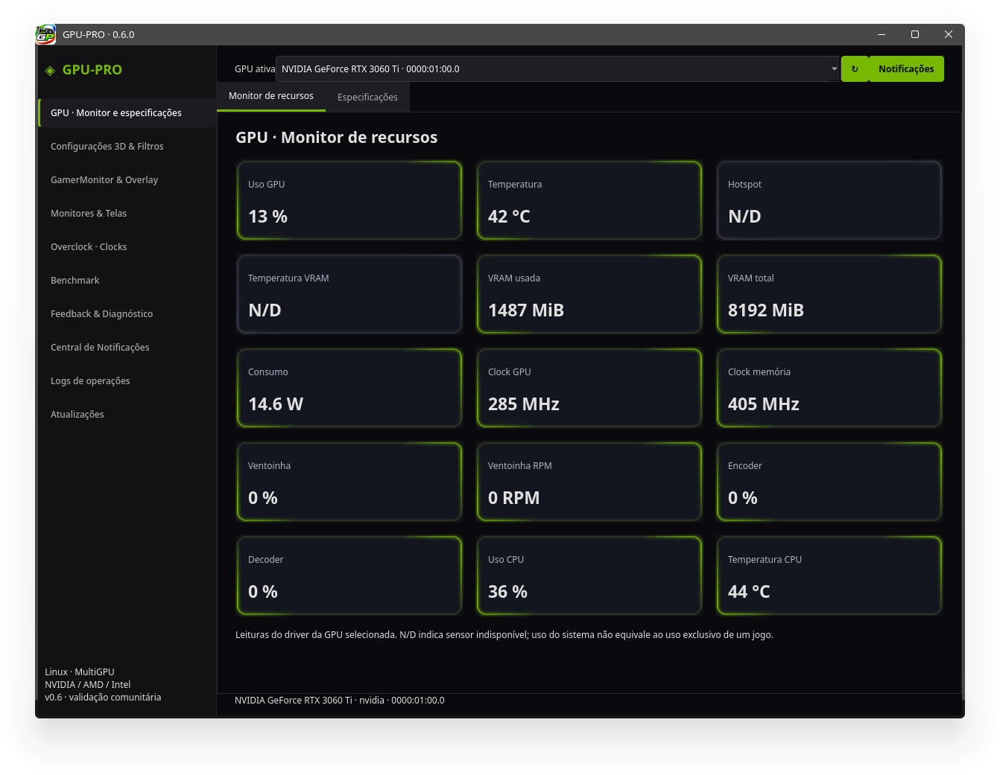
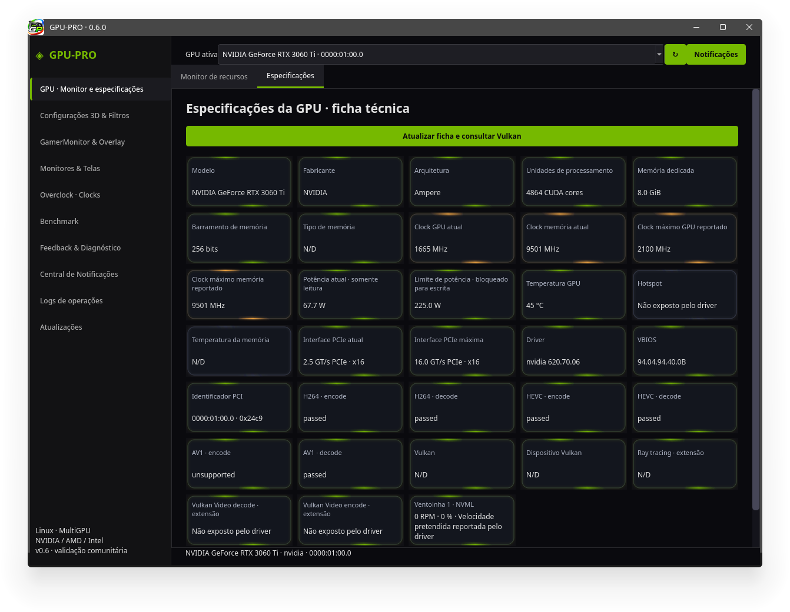
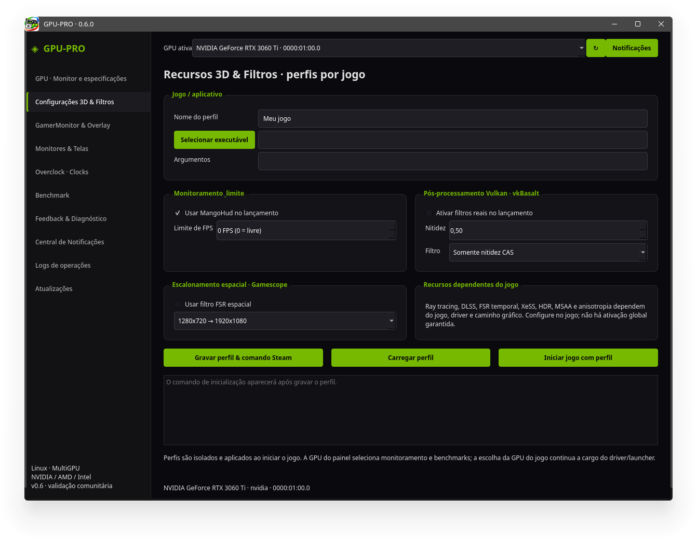
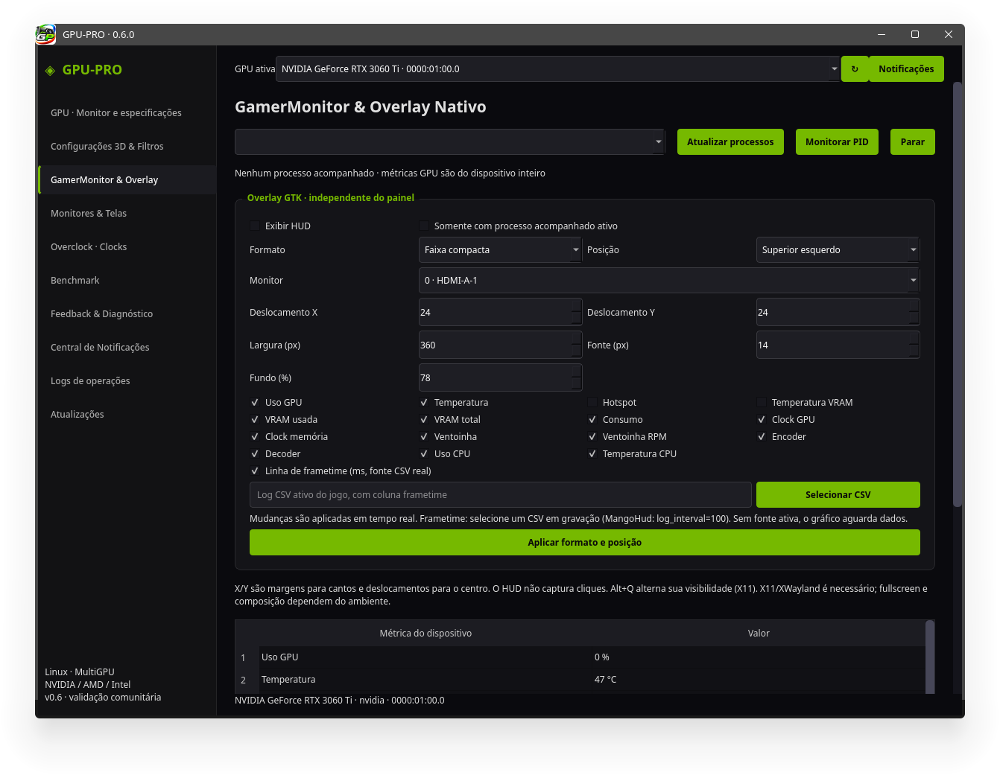

# GPU-PRO — 0.6.0

**Titular: Ériton do Nascimento** · [Instalação](docs/INSTALACAO.md) · [Contribuir](CONTRIBUTING.md) · [Licença source available](LICENSE)

> **Aviso de riscos e responsabilidade:** ajustes de clocks e cargas intensivas podem causar travamentos, perda de dados e danos ao equipamento. Você é responsável pelas alterações que decidir realizar. O software é fornecido sem garantia, nos limites da legislação aplicável; direitos obrigatórios permanecem preservados. Leia o [aviso completo](docs/AVISO-DE-RESPONSABILIDADE.md). O acesso ao Overclock exige aceite explícito em cada sessão.

Repositório oficial: https://github.com/eritongrnascimento-svg/GPU-PRO

Versão inicial para validação da comunidade; AMD/Intel ainda precisam de testes em hardware. Veja os [resultados reais e limites](docs/VERIFICACAO.md).

Desenvolvo o GPU-PRO para oferecer monitoramento e ferramentas de teste MultiGPU no Linux, com backends NVIDIA, AMD e Intel. Neste repositório você encontra o aplicativo em C++20 / Qt 6, os instaladores e as instruções para usar e contribuir. O projeto nasceu de um protótipo Python, mantido separadamente. A coleta de resultados é local e permite colaboração da comunidade; não há servidor, upload automático ou rede neural treinada.

## Licenças das integrações com o sistema

**Não incorporamos nem vinculamos bibliotecas de terceiros exclusivamente GPL ao código original do GPU-PRO.** A manutenção utiliza programas externos fornecidos pela distribuição, como `pacman`, `apt-get`, `dnf`, `pactl` e `bubblewrap`, conforme o backend disponível. Esses programas são executados como processos independentes, pelos seus comandos nativos; não copiamos seu código nem vinculamos a biblioteca `libalpm` ao aplicativo.

O código original mantém a licença [GPU-PRO Source Available License](LICENSE). Isso não significa ausência de dependências livres: Qt é utilizado sob LGPL, outras bibliotecas e runtimes possuem termos próprios, e ferramentas externas podem ter licença GPL. Esses componentes preservam seus direitos e obrigações; as restrições do GPU-PRO não se estendem a eles. O AppImage inclui bibliotecas identificadas no manifesto e nas fontes correspondentes da release. Consulte [NOTICE](NOTICE) e [Licenças](docs/LICENCAS.md).

## Iniciar

```sh
./run.sh
```

Abertura: leitura de sensores apenas. Nada de overclock, tensão, power limit, testes ou HUD é aplicado automaticamente. **Esta versão não possui operação para alterar tensão ou limite de potência**, inclusive no helper privilegiado. A potência continua disponível como leitura.

Prévia offline, sem inicializar a GPU:

```sh
./run.sh --preview-offline
./run.sh --preview-offline --preview-page 2
```

Escolha o formato adequado ao seu sistema na [última release](https://github.com/eritongrnascimento-svg/GPU-PRO/releases/latest). Os pacotes oficiais usam Linux x86_64 e base Ubuntu 24.04; o AppImage exige glibc 2.39 ou posterior. TAR/RUN e DEB utilizam bibliotecas do sistema. Se houver incompatibilidade de ABI, Qt ou glibc, compile com `build.sh`. O projeto não distribui drivers NVIDIA/AMD/Intel, e bibliotecas de um fabricante não devem ser copiadas para sistemas de outro.

## Capturas de tela

GPU-PRO 0.6.0 — capturas de 11/11/2026, apresentadas da mais antiga para a mais recente.

| 01 · Monitor de recursos · 11:36:30 | 02 · Especificações da GPU · 11:36:49 |
|---|---|
| [](docs/capturas/v0.6.0/01-20261111-113630.png) | [](docs/capturas/v0.6.0/02-20261111-113649.png) |
| 03 · Recursos 3D e filtros · 11:37:03 | 04 · GamerMonitor e overlay · 11:37:12 |
| [](docs/capturas/v0.6.0/03-20261111-113703.png) | [](docs/capturas/v0.6.0/04-20261111-113712.png) |

[**Ver as oito capturas em ordem, incluindo monitores, overclock, benchmark e atualizações →**](docs/capturas/v0.6.0/README.md)

## Organização da interface

- **GPU**, primeiro menu: Monitor de recursos e Especificações, com cards neon animados.
- **GamerMonitor**: controles de processo/overlay e métricas com rolagem de página.
- **Benchmark**: abas 3D/Jogos, Computação, Encoder/Decoder e Gargalo.
- **Atualizações**: consulta manual às releases oficiais, backup anterior à instalação e restauração.

A cor das bordas acompanha faixas das leituras. Clocks e RPM altos não significam, por si só, falha. Sensores ausentes ficam N/D. O hotspot só é exibido quando o driver fornece uma leitura identificada; não é temperatura média mais um valor calculado. Memória junction não é confundida com hotspot.

O teste 3D dura **30 ou 60 segundos**, mais 2 s de aquecimento, e exibe a cena ao vivo. São três cenas procedurais próprias, com câmera, iluminação, sombras e reflexos por shader. Não é conteúdo nem pontuação do AnTuTu. Veja [o método](docs/BENCHMARKS.md).

## Recursos

- **GamerMonitor** reúne o monitor de processos e as configurações do overlay; esse menu substituiu o antigo monitor individual.
- A página exclusiva MangoHud foi removida. A integração por perfil continua opcional para métricas/limite de FPS. FSR, DLSS, geração de quadros e upscale não dependem do MangoHud; dependem dos seus respectivos jogos, drivers e integrações.
- **Superior centralizado** no overlay, além dos cantos, centro e coordenadas; X controla deslocamento horizontal e Y a margem superior nessa âncora.
- **GPU/3D:** Vulkan e OpenGL, renderização offscreen real em 720p, 1080p, 1440p, 4K ou 8K, sem precisar de monitor dessa resolução. Verifica a GPU utilizada, limites de imagem e alocação. Software rendering não recebe pontuação válida.
- **Computação:** aba dentro de Benchmark, com kernels Vulkan para leitura, escrita, cópia, FP32, FP64, inteiros de 32 e 64 bits; features indisponíveis são identificadas. Valores em GB/s, GFLOPS e GIOPS, sem misturar unidades em um score único.
- **Encoder + Decoder:** uma suíte de seis etapas, H.264 encode/decode, HEVC encode/decode e AV1 encode/decode, com cobertura explícita. Codec incompatível não se transforma em zero fictício; falha de execução impede score consolidado.
- **Históricos:** banco SQLite local, três testes recentes por GPU/categoria, seleção para reabrir o resultado e sua imagem. Os demais registros continuam no banco para feedback.
- **Exportação:** PNG, JPEG e JSON do teste selecionado.
- **Gargalo:** referência Vulkan 720p e resolução alvo selecionável de 720p a 8K, com trabalho CPU fixo, tempos, percentuais estimados e resumo. O modelo usa sobreposição ideal CPU/GPU; não mede perda universal de FPS em jogos.
- **Sensores:** temperatura NVML atualizada, RPM e porcentagem por ventoinha quando expostos; descoberta de canais hwmon, incluindo junction/hotspot e memória. O driver pode não expor determinados sensores. `0 RPM` e `N/D` têm significados diferentes.
- **Especificações:** ficha técnica organizada com arquitetura, memória, barramento, unidades reportadas, clocks, potência somente leitura, PCIe, driver, VBIOS, Vulkan e resultados de vídeo já testados.
- **Clocks:** barras deslizantes e valores legíveis; candidato NVIDIA de +15 MHz para teste curto com restauração. AMD/Intel mantêm controles manuais somente quando o driver expõe capacidades reconhecidas.

## Compartilhar resultados com o projeto

1. Instale ou compile o aplicativo para o seu sistema.
2. Execute os benchmarks desejados, inicialmente com a configuração padrão.
3. Abra **Feedback & Diagnóstico → Gerar feedback**.
4. Revise o JSON mostrado e salve o arquivo.
5. Se desejar contribuir com a validação, envie o arquivo manualmente pelo canal de colaboração acordado com o projeto.
6. Para consultar arquivos recebidos de outros participantes, use **Importar feedback de amigos**; esse é o nome atual do botão na interface.

O feedback inclui resultados, versão do método, configurações, identificação técnica da GPU, driver, VBIOS e telemetria dos testes. Exclui UUID/serial, hostname, usuário, nomes de processos, caminhos de jogos, argumentos e logs brutos. A exportação é limitada a 16 MiB / 2000 registros recentes e informa quando precisa truncar. Os registros antigos permanecem no banco.

Importações são validadas, sanitizadas, deduplicadas por UUID do **teste** e armazenadas como **não verificadas**. Não são promovidas a histórico local validado nem aplicadas como overclock. Exportar feedback não retransmite automaticamente os dados importados de outras pessoas.

Banco: `~/.config/LinuxGPUControl/LinuxGPUControl/results.sqlite` ou equivalente XDG. Imagens de cenas ficam em `images/` ao lado. Os JSONs da versão 0.1 permanecem no disco; os scores antigos não são recalculados nem equiparados ao método novo.

A base pode alimentar um futuro serviço ou modelo estatístico, mas uma placa não comprova estabilidade de outra. Um teste concluído comprova apenas a execução daquele protocolo, naquele ambiente.

## Clocks: limites e autorização

O auxiliar de clocks é **gpu-clock-helper**. A versão antiga `gpu-power-helper` não faz parte deste pacote. Somente o helper é executado com autorização administrativa; nunca execute a interface inteira como root.

Para instalar o helper após revisar o código:

```sh
sudo install -d -o root -g root -m 0755 /usr/local/libexec/linux-gpu-control
sudo install -o root -g root -m 0755 bin/gpu-clock-helper /usr/local/libexec/linux-gpu-control/gpu-clock-helper
```

Para compilação local, use `build/gpu-clock-helper`. Nenhuma regra polkit permissiva, sudoers ou setuid é criada. A interface verifica propriedade e permissões do executável e dos seus diretórios, e usa o diálogo do `pkexec` do sistema.

- NVIDIA: barras são offsets em MHz.
- AMD moderna: barras são tetos absolutos de frequência OverDrive. Tabelas antigas que exigem tensão são recusadas. Não habilita OverDrive no kernel automaticamente.
- Intel i915: teto nominal de frequência quando exposto; não equivale a overclock irrestrito. Xe pode não expor controle reconhecido nesta versão.
- Aplicação manual permanece no driver até restauração pelo usuário/reinicialização; carregar um candidato nas barras não o aplica.
- Teste automático NVIDIA: baseline Vulkan 720p, incremento **máximo de +15 MHz no core**, segunda carga curta e restauração. Não altera memória, tensão, power limit ou ventoinhas. Exige telemetria válida, temperatura inicial abaixo de 60 °C e GPU pouco ocupada.
- Watchdog no processo privilegiado: leitura a cada ~250 ms, parada a 75 °C / hotspot 95 °C, restauração ao receber STOP, fechar comunicação, perder o proprietário ou atingir 20 s após aplicar. Não há garantia de recuperação após falha de kernel, desligamento ou SIGKILL do próprio watchdog.

Esse teste é curto e não certifica estabilidade prolongada. Um perfil local só é marcado como resultado de teste curto, nunca como homologado pelo fabricante. Referências de outras GPUs não são aplicadas automaticamente. Ainda não há busca automática agressiva, ajuste de tensão ou curva de ventoinha.

## Compilar

Dependências: CMake 3.22+, compilador C++20, pkg-config, Qt 6 Core/Gui/Widgets/Network/OpenGL/DBus, headers libdrm, SQLite3 (API C, sem plugin Qt SQL), libarchive, GTK 3/GDK, Cairo/Pango, X11, Vulkan-Headers/loader e glslangValidator. Para executar codecs: FFmpeg com NVENC/CUDA ou VA-API conforme GPU/driver. Bibliotecas e render nodes do driver precisam estar acessíveis ao usuário.

```sh
./build.sh
ctest --test-dir build --output-on-failure
QT_QPA_PLATFORM=offscreen ./build/linux-gpu-control --ui-smoke
```

Headers Vulkan fora do sistema: `VULKAN_HEADERS_DIR=/caminho/Vulkan-Headers/include ./build.sh`.

Os shaders são compilados e incorporados ao worker; glslang não é dependência de execução. A biblioteca NVML continua opcional em runtime, e sua ausência não impede o uso das outras GPUs. O banco usa SQLite diretamente para não depender de um plugin `QSQLITE` adicional.

## Ver um resultado sem acessar a GPU

```sh
./run.sh --view-report teste.json --preview-page 5
./run.sh --view-report teste.json --export-image teste.png --ui-smoke
./run.sh --view-report teste.json --export-feedback feedback.json --ui-smoke
```

Esses comandos usam um banco em memória e não modificam o histórico principal. Para uma medição computacional: `--preview-page 5 --preview-subtab 1`. Para vídeo: `--preview-page 5 --preview-subtab 2`.

## Documentação

- [Overlay, CPU, frametime e aparência](docs/OVERLAY.md)
- [Aviso de riscos e responsabilidade](docs/AVISO-DE-RESPONSABILIDADE.md)
- [Métodos e comparabilidade](docs/BENCHMARKS.md)
- [Protocolo de feedback](docs/FEEDBACK.md)
- [Arquitetura](docs/ARQUITETURA.md)
- [Validação executada](docs/VERIFICACAO.md)
- [Roteiro para outras GPUs](docs/VALIDACAO.md)

O [registro de validação](docs/VERIFICACAO.md) documenta um teste curto em RTX 3060 Ti, com instalação do helper e restauração confirmada do clock. Esse registro histórico não instala o helper nem aplica ajustes no seu computador.

Verificação assistida para desenvolvimento (abre autenticação do sistema e executa o teste curto; não é apenas uma prévia):

```sh
./run.sh --clock-check resultado-clock.json
```

Essa opção usa o mesmo fluxo do botão, incluindo baseline, espera de ociosidade/temperatura, confirmação do offset durante a renderização e restauração. A inicialização normal, sem essa opção, não executa testes.


## Licença e publicação

Código disponível sob [GPU-PRO Source Available License 1.0](LICENSE), com forks no GitHub para auditoria/contribuição e restrições de redistribuição. Não é uma licença open source da OSI. O mantenedor decide quais PRs e releases são oficiais; dependências mantêm suas próprias licenças em [NOTICE](NOTICE).

Consulte a [revisão de compatibilidade das licenças](docs/LICENCAS.md), [Instalação](docs/INSTALACAO.md), [Publicação](docs/PUBLICACAO.md), [Changelog](CHANGELOG.md) e [Segurança](SECURITY.md).


## Novidades da versão 0.4

Desde a versão 0.4, a pasta do projeto chama-se **GPU-PRO**, preservando históricos e configurações no diretório anterior de dados do usuário. Nenhum teste ou perfil antigo é apagado.

- Especificações ajustam colunas e alturas dos cards à janela; janelas pequenas mantêm rolagem para preservar a legibilidade.
- Gargalo aceita 720p, 1080p, 1440p, 4K e 8K como resolução alvo, com referência 720p e resumo. Os percentuais estimam o limite CPU/GPU na carga sintética com sobreposição ideal; não são perda real medida de FPS em jogos.
- Atualizações inclui a opção de fechar para a bandeja e gerenciamento de drivers por APT, pacman, DNF e backend PackageKit da distribuição, com consulta de versões, simulação e confirmação no gerenciador nativo. Não adiciona repositórios externos ou instala automaticamente. Em Arch/CachyOS usa atualização completa do sistema e versão explícita.
- Novos formatos: `.deb` para Ubuntu 24.04 amd64, AppImage x86_64 e executável portátil `.run`. O `.run` inclui os workers, não exige root e utiliza bibliotecas do sistema. AppImage tem base Ubuntu 24.04/glibc 2.39 ou posterior; não é universal para distribuições antigas. Consulte as fontes correspondentes das dependências incluídas no AppImage, fornecidas junto da release.

Na versão 0.4, AppImage e DEB apenas abriam o download oficial. A versão 0.6 acrescenta download, backup e preparação da atualização pelo painel para esses formatos, mantendo o instalador nativo do DEB e a alternativa de acesso ao GitHub. O atualizador de pasta TAR/RUN continua disponível.

A detecção utiliza o gerenciador e os repositórios reais do sistema; PackageKit fornece um backend comum para outras distribuições quando instalado e funcional. NixOS e sistemas imutáveis são reconhecidos como declarativos/deployments e não recebem comandos de instalação imperativa de outra distro. Não existe garantia de instalação automática para qualquer distribuição Linux sem um backend compatível.


## Novidades da versão 0.5

- **Sair do GPU-PRO** encerra o aplicativo mesmo com a janela oculta na bandeja; operações de clocks, drivers e tela continuam protegidas contra encerramento durante a transação.
- Overlay com uso global e temperatura da CPU, alterações ao vivo e linha de frametime por CSV ativo compatível.
- Estilo Fusion/paleta fixos, fundo dos cards repintado integralmente e opção de desligar animações neon em Atualizações.
- Aviso de responsabilidade no início desta documentação e aceite obrigatório por sessão antes de acessar Overclock. Nenhum ajuste é aplicado pelo aceite.
- Documentação voltada aos visitantes e colaboradores, com procedimentos e registros históricos preservados.


## Novidades da versão 0.6

- Drivers apresentados como conjuntos completos disponíveis nos repositórios, da versão mais antiga à mais nova, com variante Open/proprietária quando aplicável. A versão instalada é exibida separadamente.
- Prévia com adições, atualizações e remoções. No Arch/CachyOS, a transação é preparada pelo `pacman` externo em um namespace somente de leitura, sem rede, e a confirmação final é recusada automaticamente. A instalação real continua exigindo autenticação e confirmação nativas.
- Restauração de driver por conjunto anterior preservado; em backends de referência, a versão precisa continuar disponível no repositório e passar por nova simulação. Backups incompletos não equivalem a garantia de rollback.
- AppImage pode ser atualizado no mesmo arquivo, com backup. DEB é baixado e verificado pelo painel, preservando o pacote oficial anterior e mostrando a simulação APT antes de instalar. O acesso ao GitHub pelo navegador continua disponível.
- Ficha Intel com consultas DRM/i915 de EUs, clocks expostos e identificação de memória compartilhada quando reconhecida. EUs não são convertidas em CUDA cores. Sensores ausentes não são estimados.
- Preferência de GPU para aplicativos compatíveis com PRIME iniciados pelo painel; configuração reversível da próxima sessão KDE Wayland quando ambas as GPUs estiverem ativas. Não altera BIOS, cabos ou aplicativos em execução.
- Alinhamento de destinos padrão de áudio com seleção explícita e restauração, preservando volumes, filtros e conexões atuais. O botão não recupera codecs que falharam antes do ALSA.
- Novo ícone `gpu-pro.png` no aplicativo e nos pacotes.

Consulte [Drivers, atualização e sistema](docs/DRIVERS-E-SISTEMA.md). A [galeria atualizada](docs/capturas/v0.6.0/README.md) apresenta as oito capturas da versão 0.6.0 em ordem cronológica. As capturas anteriores permanecem identificadas como históricas.
