# Galeria — GPU-PRO 0.4.0

As 12 capturas originais estão em ordem cronológica, pelo horário registrado no nome de cada arquivo. Capturadas em 10/11/2026 (horário de Brasília, UTC−03:00). Clique em uma imagem para abrir o arquivo em tamanho completo.

[Voltar à release 0.4.0](https://github.com/eritongrnascimento-svg/GPU-PRO/releases/tag/v0.4.0)

| Nº | Horário | Tela |
|---|---|---|
| 01 | 17:51:43 | [Monitor de recursos](#01-monitor) |
| 02 | 17:51:51 | [Especificações da GPU](#02-especificacoes) |
| 03 | 17:52:02 | [Recursos 3D e filtros por jogo](#03-recursos) |
| 04 | 17:52:14 | [GamerMonitor e overlay](#04-gamermonitor) |
| 05 | 17:52:23 | [Configurações de memória e resizable BAR](#05-memoria) |
| 06 | 17:52:31 | [Overclock e controles de clocks](#06-overclock) |
| 07 | 17:52:39 | [Benchmark GPU, 3D e jogos](#07-benchmark) |
| 08 | 17:52:48 | [Feedback e diagnóstico](#08-feedback) |
| 09 | 17:54:19 | [Atualizações do aplicativo e drivers](#09-atualizacoes) |
| 10 | 17:55:09 | [Consulta de drivers nos repositórios](#10-repositorios) |
| 11 | 17:55:28 | [Pacotes e componentes disponíveis](#11-pacotes) |
| 12 | 17:55:50 | [Versões disponíveis do driver](#12-versoes) |

## 01. Monitor de recursos

Horário: 17:51:43.

[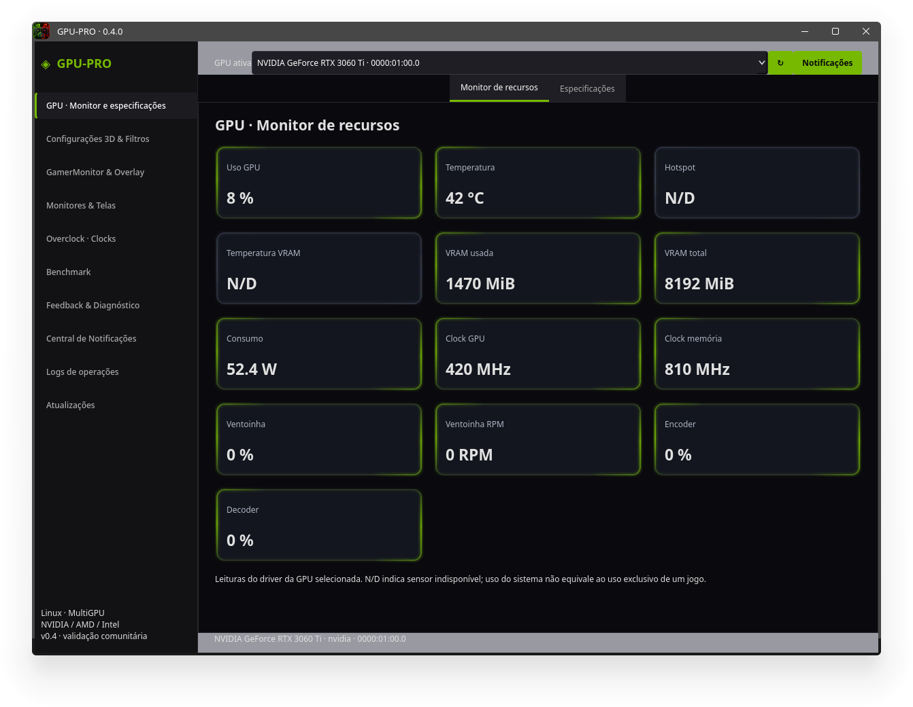](01-20261110-175143.png)

## 02. Especificações da GPU

Horário: 17:51:51.

[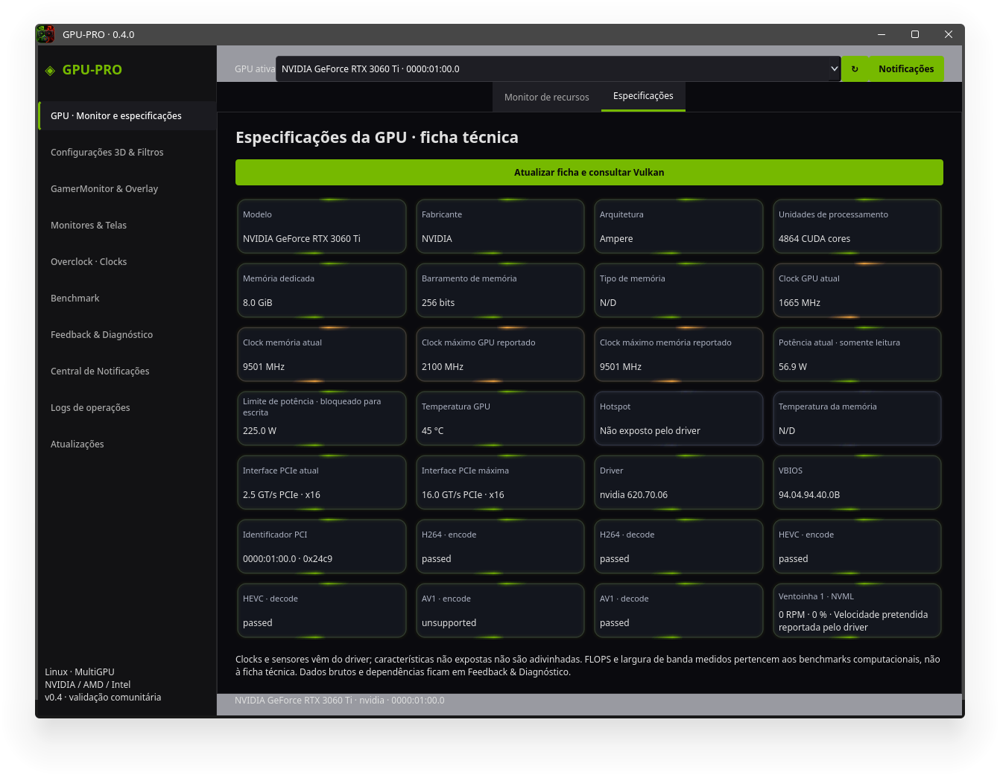](02-20261110-175151.png)

## 03. Recursos 3D e filtros por jogo

Horário: 17:52:02.

[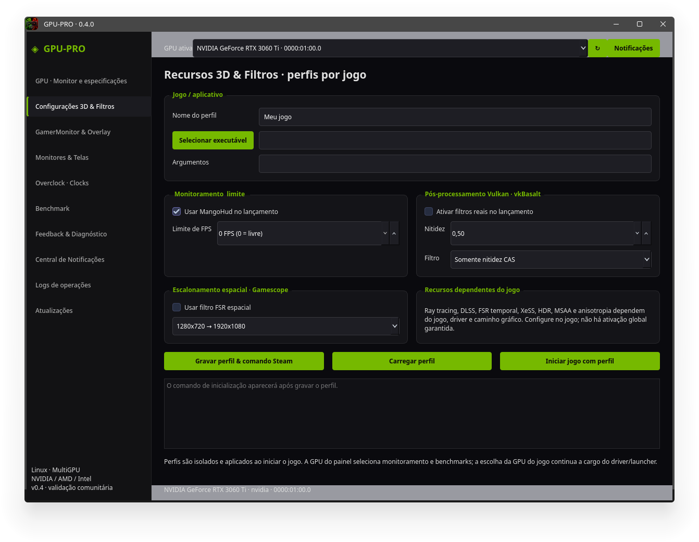](03-20261110-175202.png)

## 04. GamerMonitor e overlay

Horário: 17:52:14.

[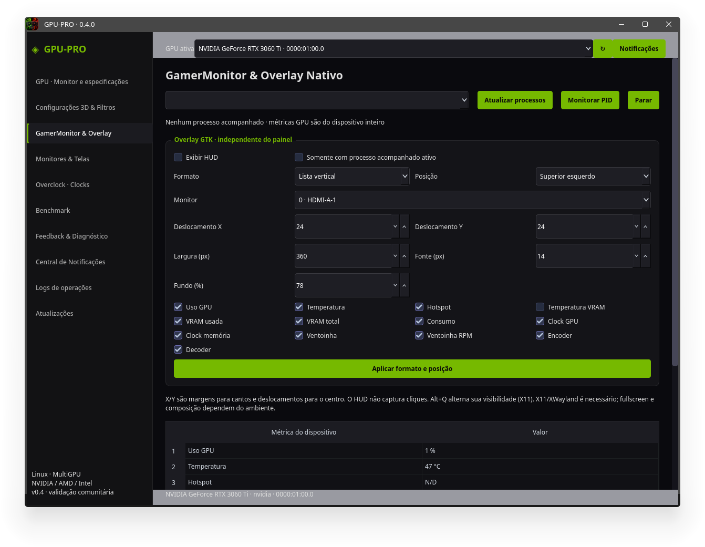](04-20261110-175214.png)

## 05. Configurações de memória e resizable BAR

Horário: 17:52:23.

[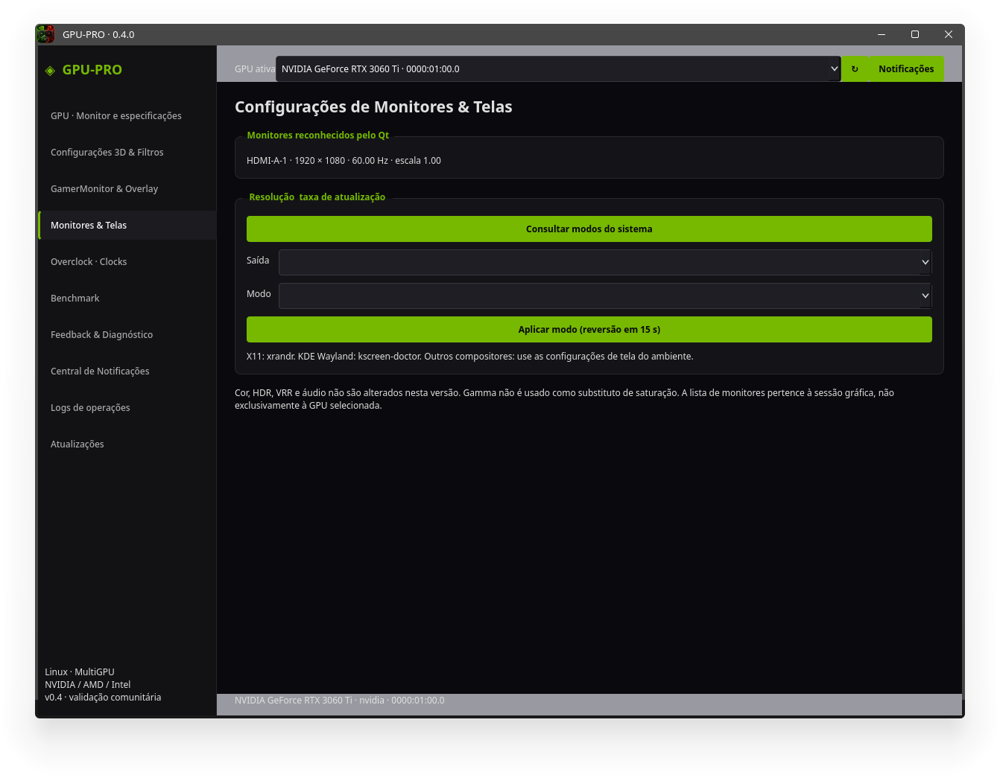](05-20261110-175223.png)

## 06. Overclock e controles de clocks

Horário: 17:52:31.

[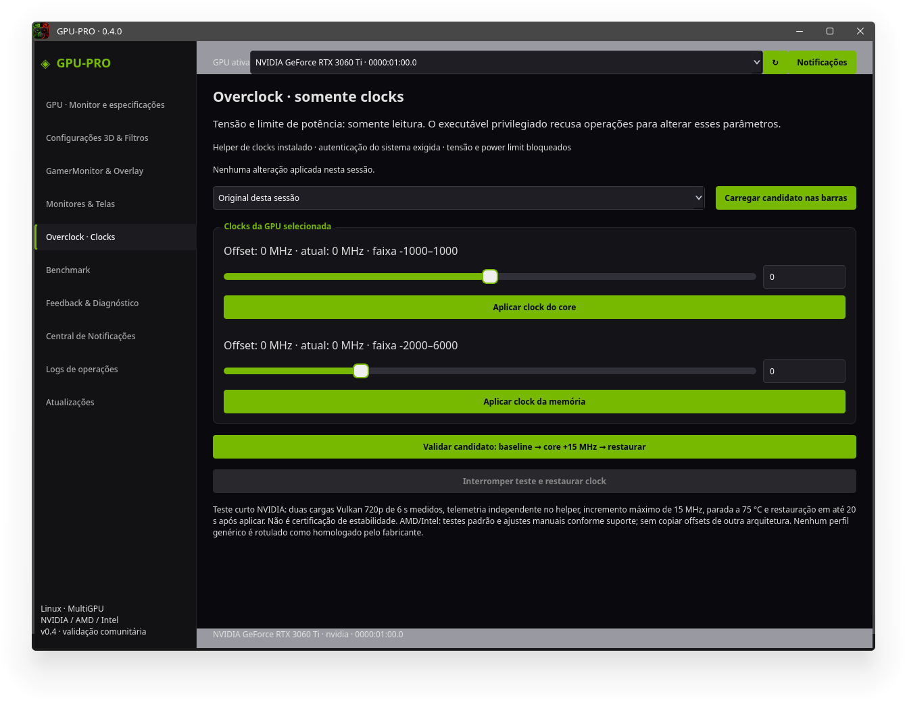](06-20261110-175231.png)

## 07. Benchmark GPU, 3D e jogos

Horário: 17:52:39.

[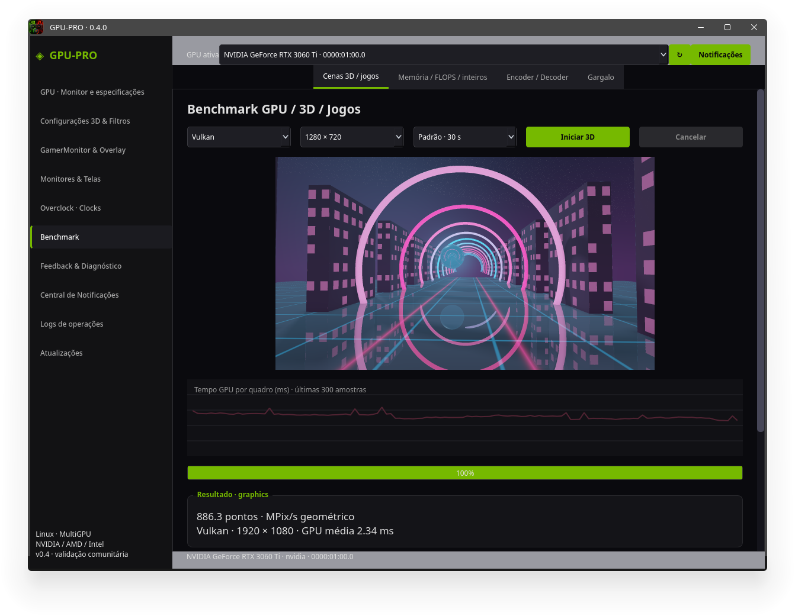](07-20261110-175239.png)

## 08. Feedback e diagnóstico

Horário: 17:52:48.

[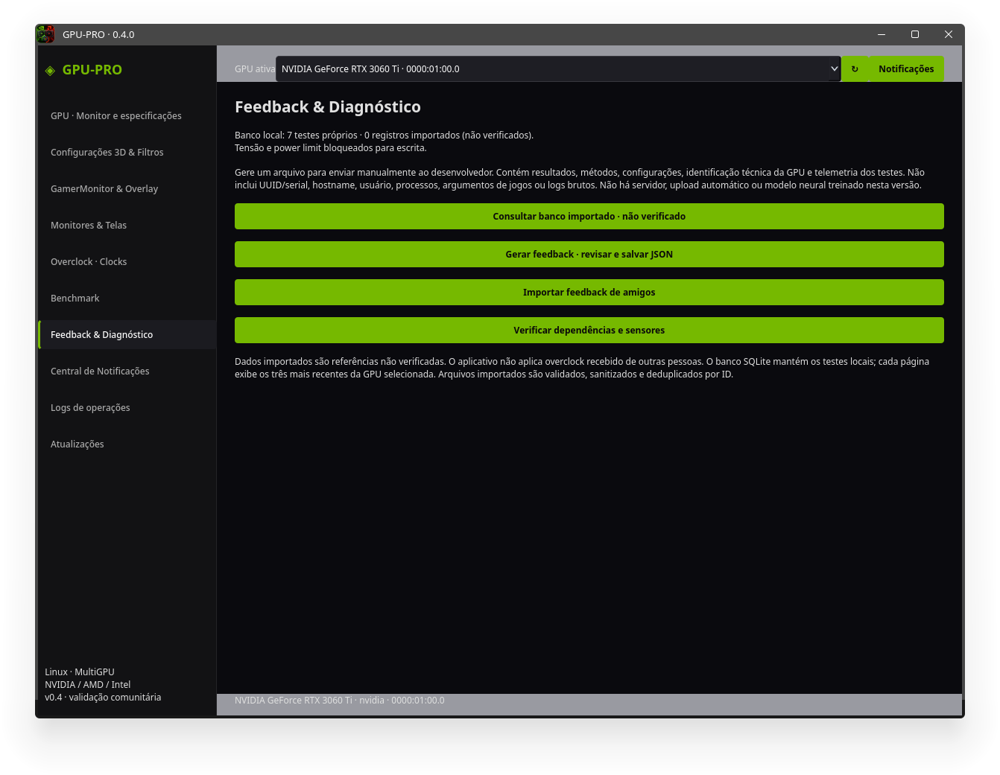](08-20261110-175248.png)

## 09. Atualizações do aplicativo e drivers

Horário: 17:54:19.

[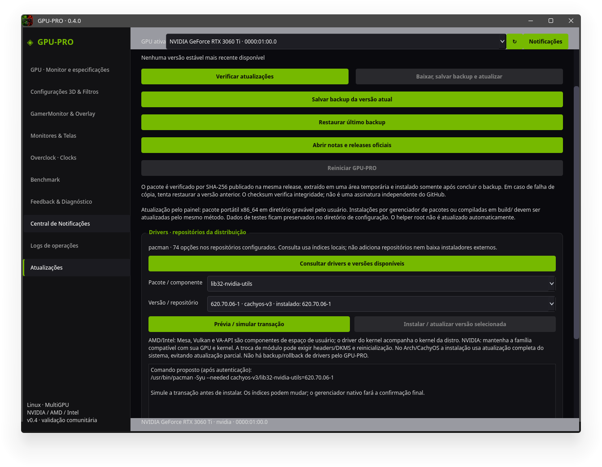](09-20261110-175419.png)

## 10. Consulta de drivers nos repositórios

Horário: 17:55:09.

[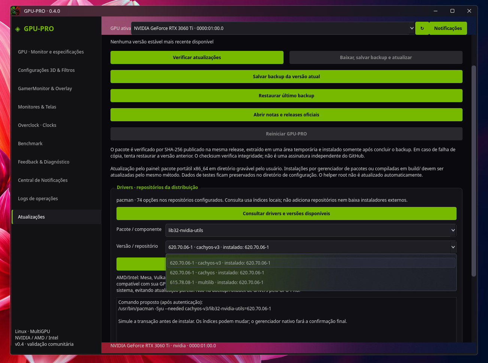](10-20261110-175509.png)

## 11. Pacotes e componentes disponíveis

Horário: 17:55:28.

[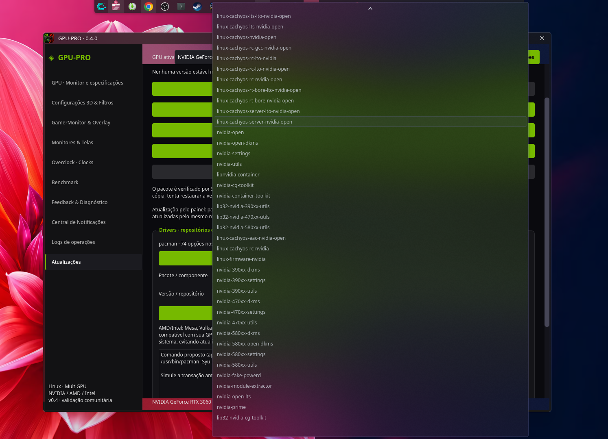](11-20261110-175528.png)

## 12. Versões disponíveis do driver

Horário: 17:55:50.

[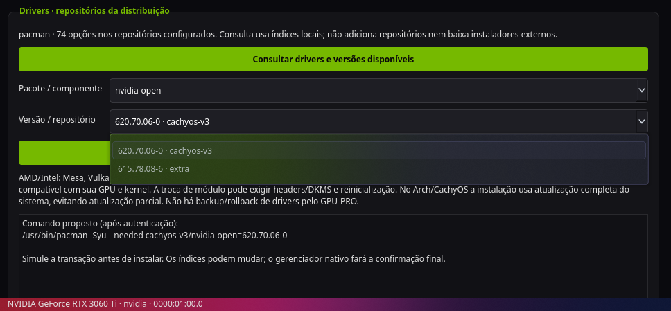](12-20261110-175550.png)
