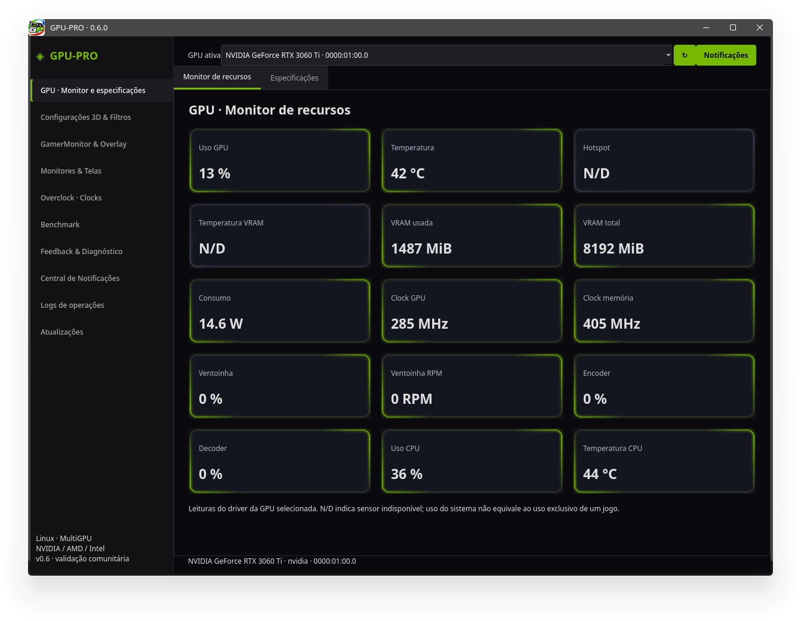
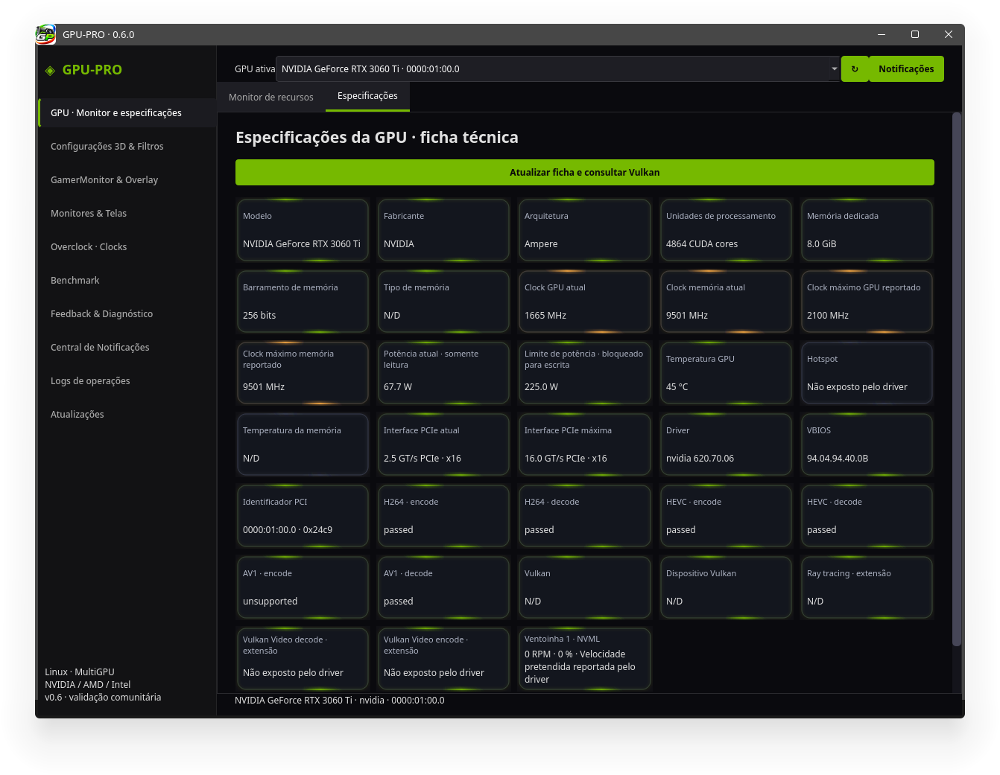
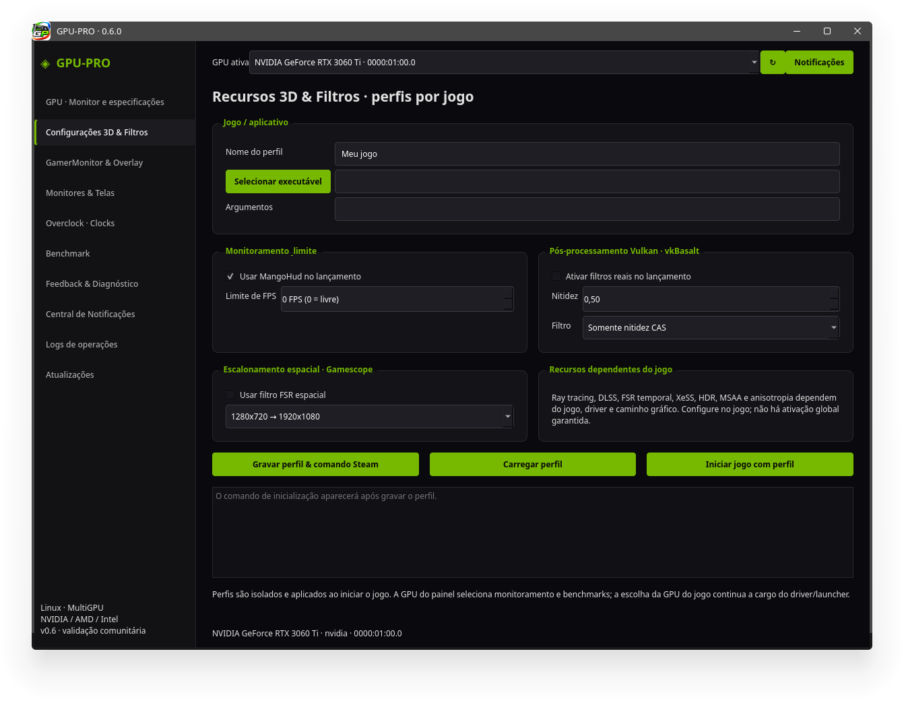
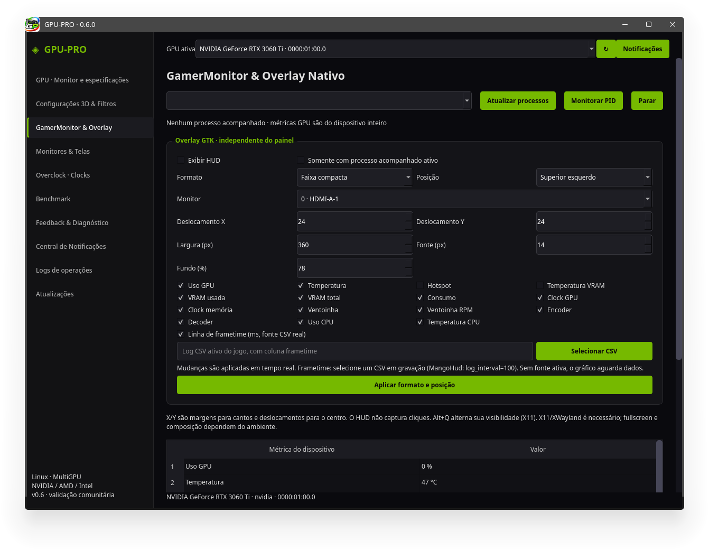
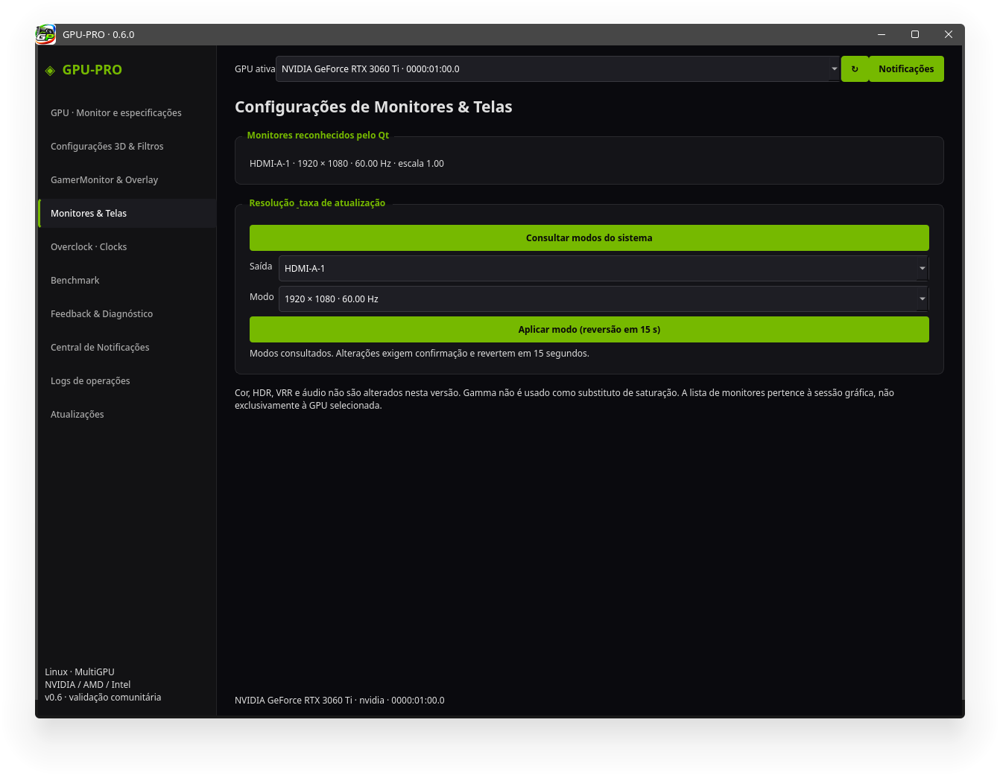
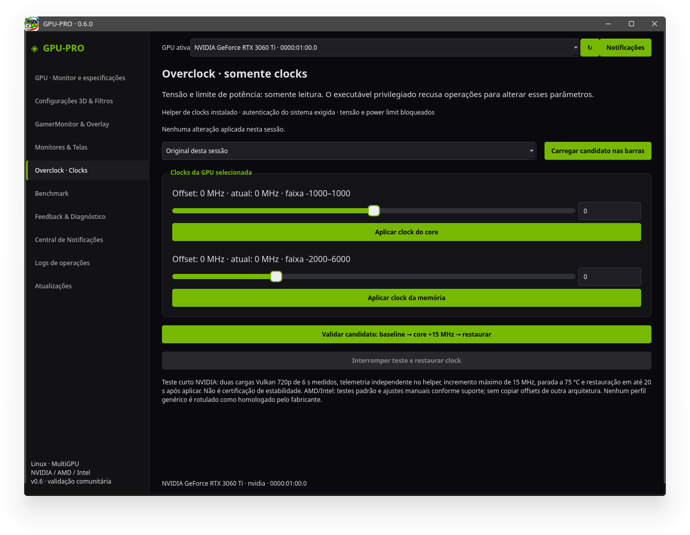
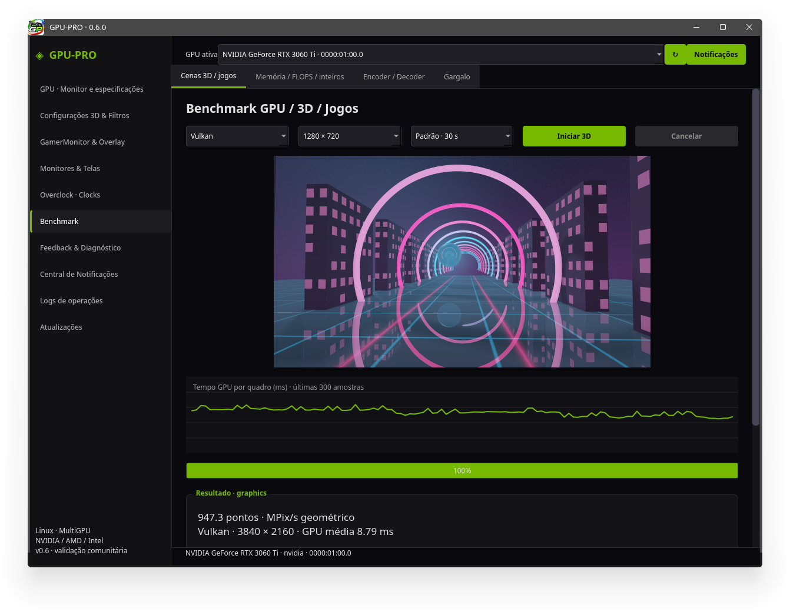
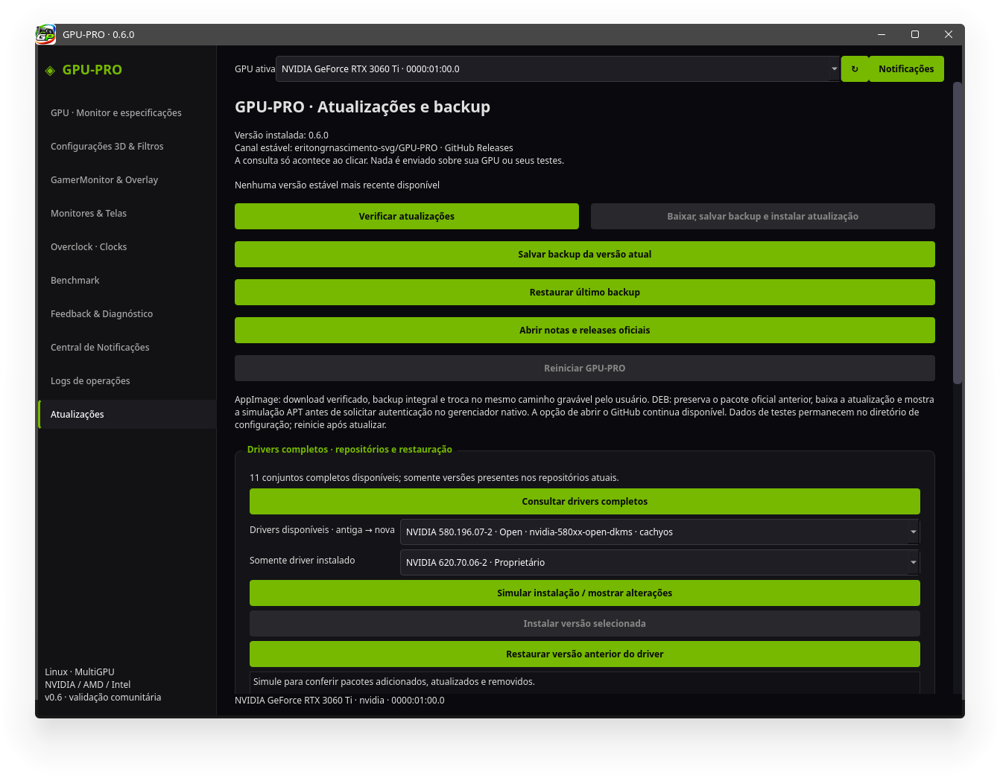

# Galeria — GPU-PRO 0.6.0

As oito capturas estão em ordem cronológica, da primeira à última, pelo horário de captura registrado nos nomes dos arquivos e confirmado pela ordem dos horários de gravação. Capturadas em **11/11/2026**, no horário de Recife/Brasília (UTC−03:00). Clique nas imagens para abrir em tamanho completo.

[Voltar ao projeto](../../../README.md) · [Release 0.6.0](https://github.com/eritongrnascimento-svg/GPU-PRO/releases/tag/v0.6.0)

| Nº | Horário | Tela |
|---|---|---|
| 01 | 11:36:30 | [Monitor de recursos](#captura-01) |
| 02 | 11:36:49 | [Especificações da GPU](#captura-02) |
| 03 | 11:37:03 | [Recursos 3D e filtros por jogo](#captura-03) |
| 04 | 11:37:12 | [GamerMonitor e overlay](#captura-04) |
| 05 | 11:37:21 | [Monitores e telas](#captura-05) |
| 06 | 11:37:52 | [Overclock e controles de clocks](#captura-06) |
| 07 | 11:38:01 | [Benchmark GPU, 3D e jogos](#captura-07) |
| 08 | 11:44:41 | [Atualizações, drivers e backups](#captura-08) |

## 01. Monitor de recursos

Horário: 11:36:30.

## 02. Especificações da GPU

Horário: 11:36:49.

## 03. Recursos 3D e filtros por jogo

Horário: 11:37:03.

## 04. GamerMonitor e overlay

Horário: 11:37:12.

## 05. Monitores e telas

Horário: 11:37:21.

## 06. Overclock e controles de clocks

Horário: 11:37:52.

## 07. Benchmark GPU, 3D e jogos

Horário: 11:38:01.

## 08. Atualizações, drivers e backups

Horário: 11:44:41.

