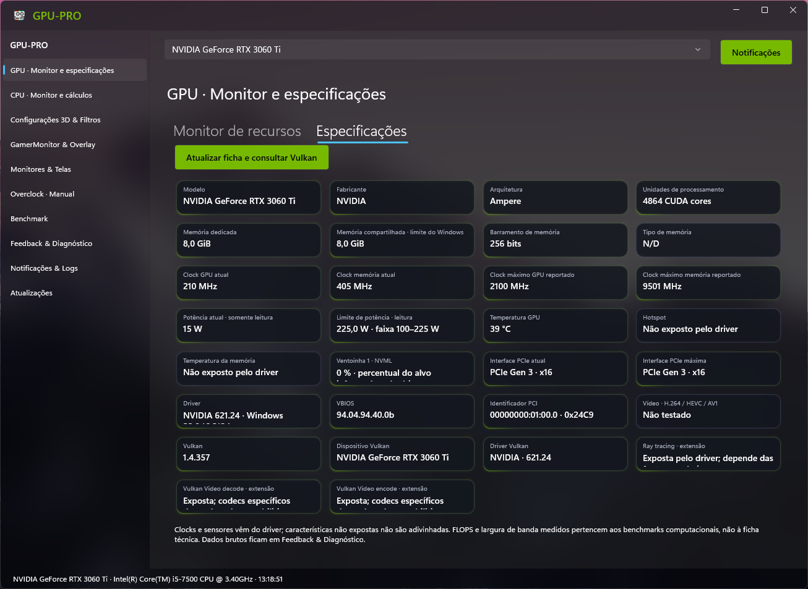
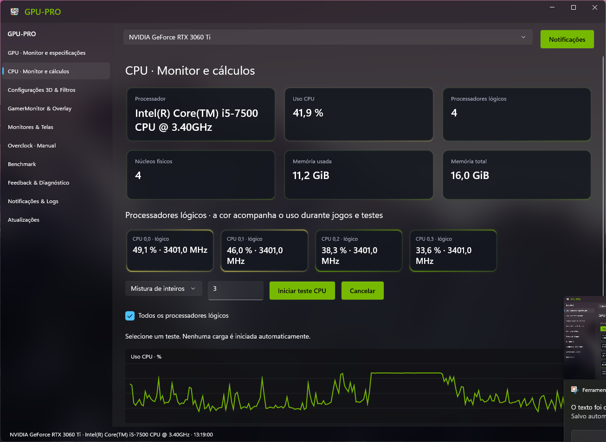
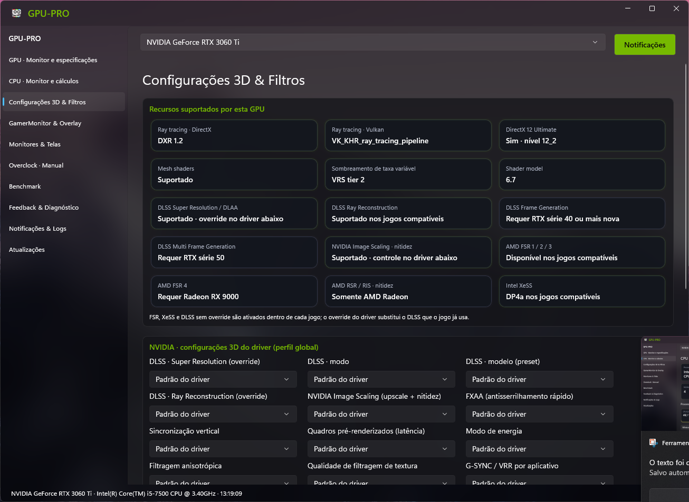
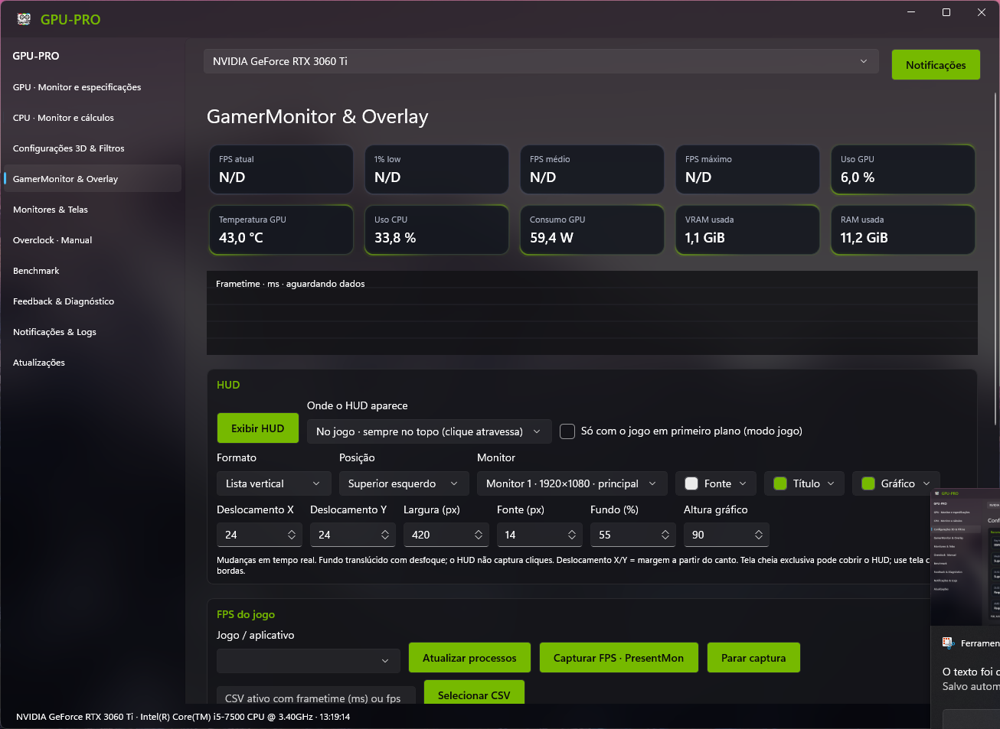
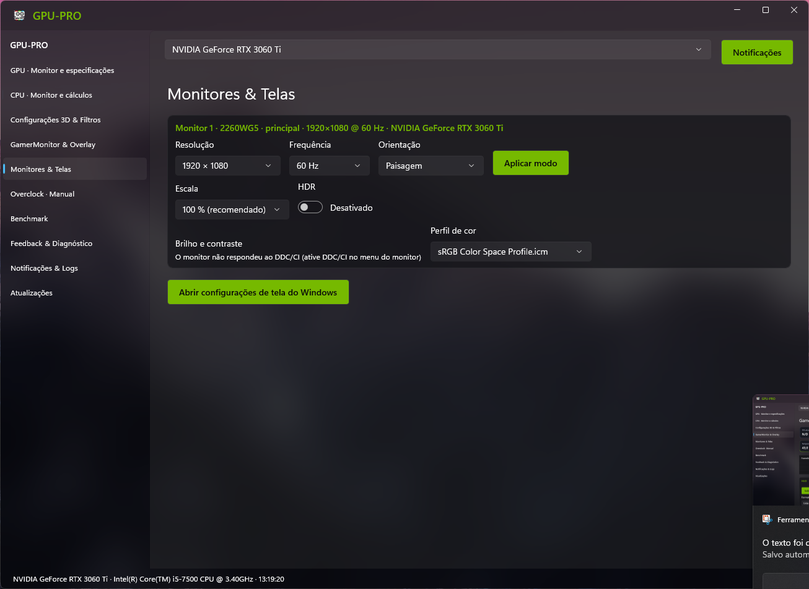
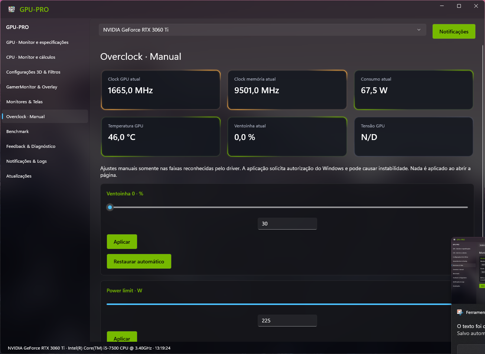
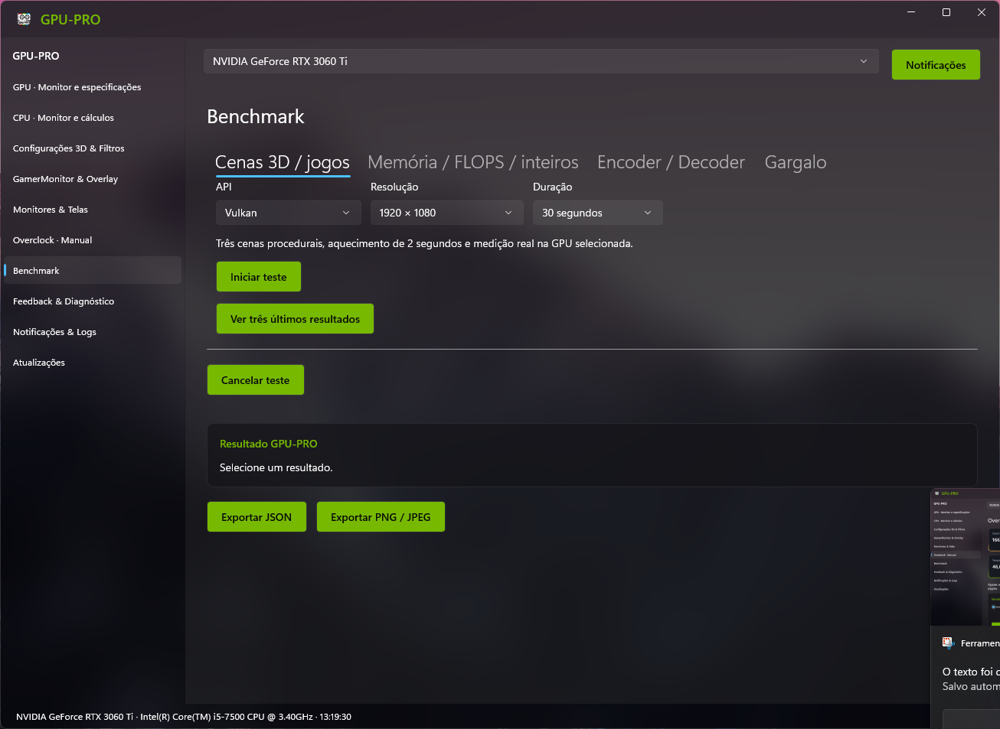
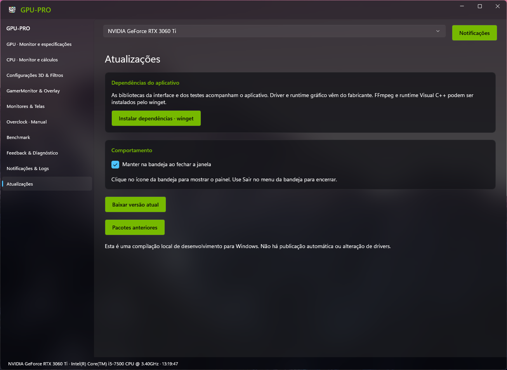
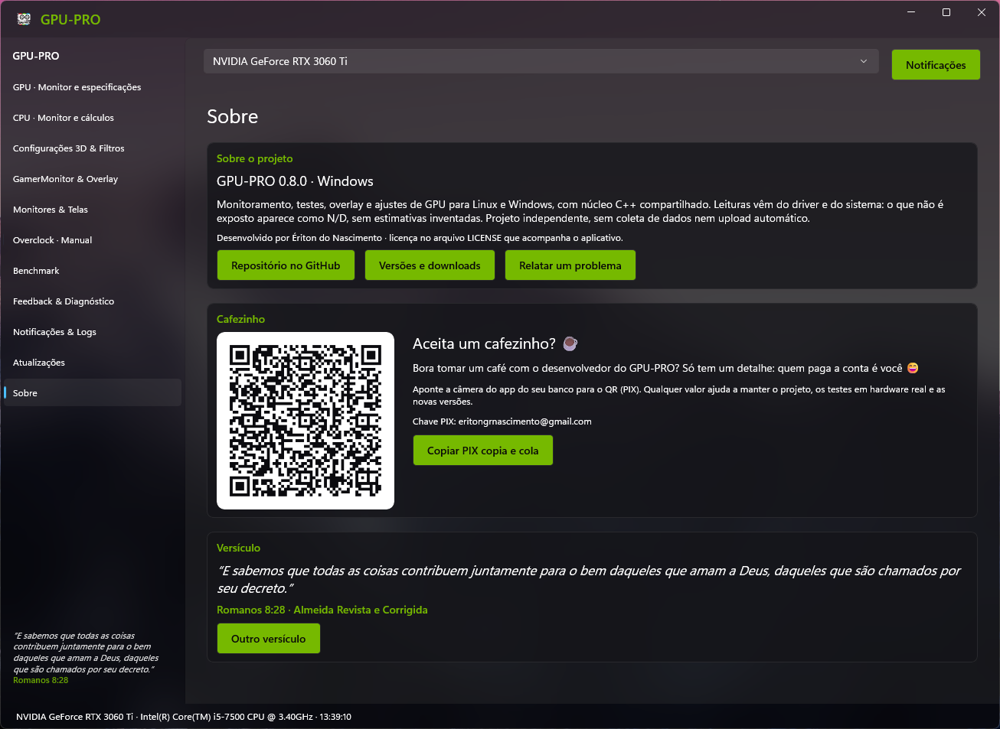
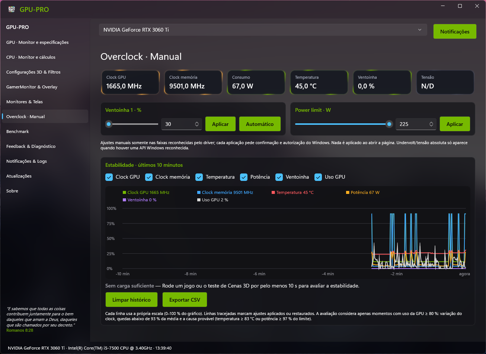

# Galeria — GPU-PRO 0.8.0 (Windows)

As dez capturas estão em ordem cronológica, da mais antiga para a mais recente, pelo horário registrado no nome de cada arquivo e confirmado pela data de gravação. Capturadas em **17/11/2026**, no horário de Recife/Brasília (UTC−03:00), na versão Windows com uma NVIDIA GeForce RTX 3060 Ti. Clique nas imagens para abrir em tamanho completo.

[Voltar ao projeto](../../../README.md) · [Release 0.8.0](https://github.com/eritongrnascimento-svg/GPU-PRO/releases/tag/v0.8.0) · [Galeria anterior (0.6.0)](../v0.6.0/README.md)

| Nº | Horário | Tela |
|---|---|---|
| 01 | 13:18:55 | [GPU · Especificações](#captura-01) |
| 02 | 13:19:05 | [CPU · Monitor e cálculos](#captura-02) |
| 03 | 13:19:11 | [Configurações 3D & Filtros](#captura-03) |
| 04 | 13:19:16 | [GamerMonitor & Overlay](#captura-04) |
| 05 | 13:19:21 | [Monitores & Telas](#captura-05) |
| 06 | 13:19:26 | [Overclock · Manual (layout anterior à compactação)](#captura-06) |
| 07 | 13:19:32 | [Benchmark](#captura-07) |
| 08 | 13:19:49 | [Atualizações](#captura-08) |
| 09 | 13:39:14 | [Sobre · cafezinho e versículo](#captura-09) |
| 10 | 13:39:42 | [Overclock · gráfico de estabilidade](#captura-10) |

As capturas 06 e 07 mostram, no canto inferior direito, a notificação da Ferramenta de Captura do Windows; ela não faz parte do aplicativo.

## 01. GPU · Especificações

Horário: 13:18:55.

## 02. CPU · Monitor e cálculos

Horário: 13:19:05.

## 03. Configurações 3D & Filtros

Horário: 13:19:11.

## 04. GamerMonitor & Overlay

Horário: 13:19:16.

## 05. Monitores & Telas

Horário: 13:19:21.

## 06. Overclock · Manual (layout anterior à compactação)

Horário: 13:19:26.

## 07. Benchmark

Horário: 13:19:32.

## 08. Atualizações

Horário: 13:19:49.

## 09. Sobre · cafezinho e versículo

Horário: 13:39:14.

## 10. Overclock · gráfico de estabilidade

Horário: 13:39:42.

